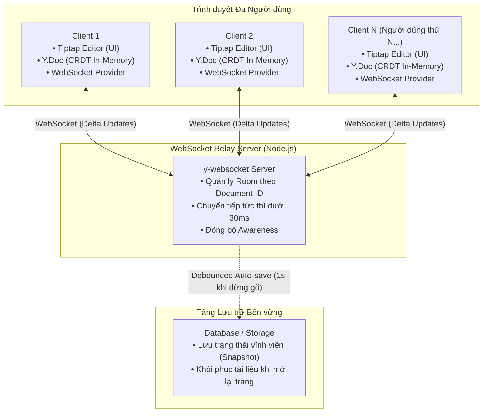
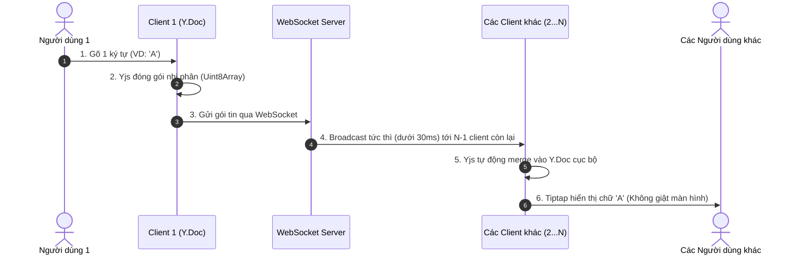

# SYSTEM DESIGN: COLLAB-DOCS
> **Hệ thống Soạn thảo Văn bản Cộng tác Thời gian thực (Real-time Collaborative Document Editor)**  
> Dự án nghiên cứu & phát triển hệ thống soạn thảo cộng tác thời gian thực không xung đột dữ liệu.  
> **Sinh viên thực hiện:** Nguyễn Đức Dương  
> **Lớp:** D18CNPM2 - Khoa Công nghệ Thông tin  
> **Trường:** Đại học Điện lực Hà Nội (EPU)  
> **Mã sinh viên:** 23810310091  

---

## 1. Tổng quan & Mục tiêu (Overview & Goals)

### 1.1. Bối cảnh & Bài toán (Problem Statement)
* **Thực trạng:** Web CRUD truyền thống dễ gây xung đột và ghi đè mất dữ liệu khi nhiều người cùng chỉnh sửa.
* **Mục tiêu dự án:** Xây dựng nền tảng soạn thảo trực tuyến real-time chuẩn văn phòng, đồng bộ tức thì và không mất dữ liệu.

### 1.2. Mục tiêu kỹ thuật cốt lõi (Core Objectives)
* **Soạn thảo trực quan (Rich-text Editing):** Hỗ trợ đầy đủ định dạng chuẩn (Tiêu đề, In đậm, Nghiêng, Danh sách, Khối mã nguồn).
* **Đồng bộ tức thời (Live Synchronization):** Mọi thao tác gõ/xóa chữ được truyền tải tức thì tới tất cả người dùng trong cùng một phòng (Room).
* **Nhận diện hiện diện (Collaborative Presence):** Hiển thị trực quan vị trí con trỏ chuột, vùng bôi đen và tên/màu sắc nhận diện của từng người đang online.
* **Hoàn tác độc lập (Collaborative Undo/Redo):** Hỗ trợ Undo/Redo phạm vi cá nhân (`Ctrl+Z`), không làm ảnh hưởng đến thao tác của người khác.
* **Tự động lưu trữ (Auto-save & Persistence):** Tự động lưu ngầm trạng thái tài liệu, đảm bảo dữ liệu không bị mất khi tải lại trang hoặc mất mạng đột ngột.

### 1.3. Yêu cầu phi chức năng (Non-Functional Requirements - NFR)
* **Độ trễ thấp (Ultra-low Latency):** Thời gian từ lúc User A gõ phím đến khi User B thấy chữ xuất hiện đạt mức < 50ms trong điều kiện mạng bình thường.
* **Tính nhất quán cuối cùng (Eventual Consistency):** Khi mất kết nối (Offline) và có mạng trở lại, hệ thống tự động hợp nhất văn bản chính xác 100% theo giải thuật CRDT mà không bị mất dữ liệu.
* **Tối ưu băng thông (Network Efficiency):** Truyền tải dữ liệu dạng vi sai (Delta updates) bằng định dạng nhị phân siêu nhẹ (< 100 bytes/thao tác), không gửi lại toàn bộ văn bản.
* **Tối ưu chi phí (Zero Infrastructure Cost):** Vận hành trên hạ tầng mã nguồn mở và nền tảng điện toán đám mây Free-tier với chi phí **0 VNĐ**.

---

## 2. Kiến trúc Hệ thống & Luồng Dữ liệu (System Architecture & Data Flow)

### 2.1. Sơ đồ Kiến trúc Tổng thể (High-level Architecture)



> **💡 Giải thích sơ đồ trong 3 ý chính:**
> 1. **Người dùng (Client 1...N):** Mỗi người gõ trên một màn hình riêng; chữ gõ ra được giữ tạm thời trên RAM của máy mình.
> 2. **Máy chủ trung gian (Relay Server):** Đóng vai trò trạm chuyển tiếp siêu tốc, hễ nhận được chữ từ ai là phát ngay lập tức sang các máy còn lại trong phòng (< 30ms).
> 3. **Cơ sở dữ liệu (Storage):** Đợi người dùng ngừng gõ 1 giây mới gom bài ghi xuống ổ cứng một lần để chống nghẽn hệ thống.

---

### 2.2. Phân tích các Thành phần Chính (Core Components)

1. **Client-side (Trình duyệt người dùng):**
   * **Tiptap Editor:** Tầng giao diện (UI) nhận tương tác gõ phím và định dạng văn bản (Heading, Bold, Italic, List...).
   * **Y.Doc (CRDT Local State):** Cấu trúc dữ liệu dạng cây nằm ngay trên RAM trình duyệt, đóng gói thao tác thành các gói tin nhị phân siêu nhẹ (< 50 bytes).
   * **WebSocket Provider:** Kênh truyền thông 2 chiều duy trì kết nối liên tục với Server, tự động kết nối lại khi có mạng (Auto-reconnect).

2. **Server-side (WebSocket Relay Server):**
   * Hoạt động theo mô hình **Room-based**: Mỗi tài liệu tương ứng với một phòng riêng biệt theo `documentId`.
   * **Xử lý siêu tốc (< 30ms):** Nhận gói tin từ một client bất kỳ và phát tán (broadcast) ngay lập tức tới $N - 1$ client còn lại trong phòng. Server không cần tính toán nặng, đảm bảo khả năng mở rộng (Scalability) cao.

3. **Persistence Layer (Lưu trữ bền vững):**
   * Áp dụng kỹ thuật **Debounce (1 giây sau khi dừng gõ)**: Gom toàn bộ các thay đổi gần nhất để ghi xuống Database 1 lần, loại bỏ hoàn toàn hiện tượng nghẽn I/O khi nhiều người gõ liên tục.

---

### 2.3. Luồng Dữ liệu khi Gõ phím (Real-time Typing Data Flow)



> **💡 Giải thích luồng truyền tin (6 bước tóm gọn):**
> * Khi **Người dùng 1 gõ phím**, máy không gửi cả trang tài liệu mà chỉ gói đúng ký tự vừa gõ thành mẩu tin nhị phân siêu nhẹ (bước 1-2).
> * Mẩu tin được **bắn qua Server** rồi **phát ngay sang các máy khác** (bước 3-4).
> * Máy người nhận tự ráp ký tự đó vào đúng vị trí và **hiển thị lên màn hình** mà không làm giật hay nhảy con trỏ chuột của họ (bước 5-6).

---

### 2.4. Cơ chế Nhận diện Hiện diện (Presence & Awareness)
* **Con trỏ chuột & Vùng chọn:** Mỗi Client liên tục gửi tọa độ con trỏ (`cursor`), vùng bôi đen (`selection`), tên hiển thị và mã màu đại diện.
* **Hiển thị trực quan:** Màn hình các Client khác sẽ vẽ vạch con trỏ nhấp nháy kèm nhãn tên của từng người đang cùng gõ để tránh xung đột thao tác trên cùng một dòng.
* **Dọn dẹp tự động (Heartbeat):** Khi một Client đóng tab hoặc mất mạng, trạng thái con trỏ của người đó sẽ tự động bị xóa khỏi màn hình sau vài giây.


---

## 3. Cơ chế Giải quyết Xung đột & Mô hình Dữ liệu (Conflict Resolution & Data Model)

### 3.1. Bài toán Xung đột Đồng thời (The Concurrency Problem)
* **Tình huống thực tế:** Giả sử văn bản ban đầu có từ `"CAT"`. Cùng một thời điểm:
  * Người dùng 1 chèn chữ `"S"` vào cuối để thành `"CATS"`.
  * Người dùng 2 chèn chữ `"A"` vào giữa để thành `"CAAT"`.
* **Nếu dùng Web CRUD thông thường:** Người nào bấm Lưu sau sẽ ghi đè và làm mất hoàn toàn chữ của người bấm trước.
* **Giải pháp của hệ thống:** Áp dụng cấu trúc dữ liệu **CRDT (Conflict-free Replicated Data Type)**. Mỗi ký tự khi sinh ra sẽ có một ID toán học riêng biệt, giúp các máy tự động hợp nhất (merge) để cho ra kết quả đồng nhất trên màn hình của tất cả mọi người mà không cần can thiệp thủ công.

---

### 3.2. So sánh Kỹ thuật: CRDT (Yjs) vs OT (Operational Transformation)

| Tiêu chí | OT (Operational Transformation) | CRDT (Yjs - Hệ thống của chúng ta) |
| :--- | :--- | :--- |
| **Bản chất** | Biến đổi vị trí (index) của ký tự dựa trên một máy chủ trung tâm làm trọng tài. | Mỗi ký tự được gắn một **ID toàn cầu duy nhất** (Client ID + Timestamp). |
| **Vai trò Máy chủ** | Máy chủ phải tính toán thuật toán rất nặng để giải quyết xung đột. | Máy chủ **không cần tính toán**, chỉ làm nhiệm vụ chuyển tiếp gói tin (Relay). |
| **Khả năng Offline** | Xử lý khi mất mạng rất phức tạp, dễ lỗi lệch dòng khi có mạng trở lại. | Tự động hợp nhất 100% khi có mạng lại mà **không bao giờ bị mất chữ**. |
| **Tài nguyên RAM** | Rất nhẹ vì chỉ lưu chuỗi ký tự thuần túy. | Cần thêm bộ nhớ lưu metadata (Yjs đã tối ưu bằng cơ chế nén nhị phân). |
| **Chi phí vận hành** | Tốn kém vì máy chủ đòi hỏi CPU mạnh để tính toán biến đổi liên tục. | Cực thấp, vận hành mượt mà trên các nền tảng đám mây miễn phí. |

---

### 3.3. Mô hình Dữ liệu (Data Model Schema)

Hệ thống quản lý 2 dạng dữ liệu cốt lõi:

#### 1. Dữ liệu Tài liệu lưu trữ (Document Record - Database)
```typescript
interface DocumentRecord {
  id: string;              // Định danh duy nhất của tài liệu (UUID: 'doc_12345')
  title: string;           // Tên tài liệu (Mặc định: 'Tài liệu chưa đặt tên')
  createdAt: Date;         // Ngày tạo tài liệu
  updatedAt: Date;         // Lần chỉnh sửa cuối
  ownerId?: string;        // ID người sở hữu (dùng cho tính năng phân quyền)
  dataSnapshot: Uint8Array;// Snapshot nhị phân của Y.Doc để lưu trữ vĩnh viễn
}
```

#### 2. Dữ liệu Trạng thái Trực tuyến (User Presence / Awareness)
```typescript
interface UserPresence {
  clientId: number;        // ID phiên kết nối Yjs của người dùng
  user: {
    name: string;          // Tên hiển thị (Ví dụ: 'Nguyễn Đức Dương')
    color: string;         // Mã màu đại diện con trỏ chuột (Ví dụ: '#2563EB')
  };
  cursor: {
    anchor: number;        // Vị trí bắt đầu vùng chọn (Selection start)
    head: number;          // Vị trí con trỏ chuột hiện tại (Caret position)
  } | null;
}
```


---

## 4. Công nghệ Sử dụng & Lý do Lựa chọn (Tech Stack & Choices)

### 4.1. Bảng Tổng hợp Công nghệ (Tech Stack Overview)

| Tầng Hệ thống | Công nghệ Lựa chọn | Vai trò trong Hệ thống |
| :--- | :--- | :--- |
| **Frontend Framework** | **Next.js (React) + TypeScript** | Xây dựng giao diện, quản lý State, đảm bảo code chặt chẽ và không dính lỗi kiểu dữ liệu. |
| **Giao diện & Styling** | **Tailwind CSS + Lucide Icons** | Thiết kế giao diện hiện đại, tối giản theo chuẩn văn phòng cao cấp. |
| **Trình soạn thảo văn bản** | **Tiptap (v2)** | Bộ khung soạn thảo văn bản không giao diện (Headless), hoạt động cực kỳ mượt mà. |
| **Thuật toán Real-time** | **Yjs** | Cấu trúc dữ liệu phân tán cốt lõi, tự động giải quyết xung đột khi nhiều người cùng gõ. |
| **Đường truyền mạng** | **y-websocket** | Kết nối 2 chiều liên tục để truyền tải các gói tin nhị phân siêu nhẹ. |
| **Máy chủ Trung gian** | **Node.js (y-websocket server)** | Quản lý phòng (Room) theo tài liệu và chuyển tiếp tin tức thì giữa các người dùng. |
| **Cơ sở dữ liệu** | **PostgreSQL (Supabase / Neon)** | Lưu trữ tài liệu lâu dài và an toàn. |

---

### 4.2. Lý do Lựa chọn Công nghệ Cốt lõi (Key Decisions)

#### 1. Tại sao chọn Tiptap mà không dùng Quill hay Slate?
* **Tương thích hoàn hảo với Yjs:** Tiptap có sẵn module kết nối trực tiếp với Yjs, không bao giờ bị lỗi nhảy hay lệch con trỏ chuột khi nhiều người gõ cùng lúc.
* **Tự do thiết kế giao diện:** Tiptap cho phép tự thiết kế thanh công cụ (Toolbar), nút bấm và phím tắt theo ý thích mà không bị gò bó bởi giao diện mặc định.

#### 2. Tại sao chọn Yjs mà không dùng Automerge?
* **Tốc độ nhanh và ít tốn RAM:** Yjs có tốc độ xử lý nhanh hơn từ 10 đến 100 lần so với Automerge khi tài liệu dài, đồng thời ngốn rất ít RAM nhờ thuật toán nén dữ liệu độc quyền.
* **Hỗ trợ tận răng:** Có sẵn toàn bộ thư viện kết nối mạng (`y-websocket`), chỉ việc lắp ghép vào là chạy được ngay.

#### 3. Tại sao chọn Next.js & TypeScript?
* **Chống lỗi lúc code (Type-safety):** Ứng dụng real-time có rất nhiều dữ liệu mạng bay qua lại, TypeScript giúp phát hiện và chặn đứng mọi lỗi cú pháp ngay khi đang gõ code.
* **Cấu trúc thư mục tiện lợi:** Next.js giúp chia mỗi tài liệu thành một đường link riêng biệt (`/doc/id_tai_lieu`) cực kỳ tự nhiên và gọn gàng.

---

### 4.3. Nơi Triển khai Hệ thống (Deployment Strategy)

Hệ thống được thiết kế để đưa lên mạng chạy thực tế mà không cần cấu hình phức tạp:
* **Giao diện Web (Frontend):** Đưa lên **Vercel** (kết nối trực tiếp với GitHub, code xong là web tự cập nhật).
* **Máy chủ Real-time (Relay Server):** Đưa lên **Render** (đảm bảo đường truyền WebSocket chạy liên tục 24/7).
* **Cơ sở dữ liệu (Database):** Dùng **Neon** hoặc **Supabase** (lưu trữ Postgres trên đám mây, tự động sao lưu dữ liệu).


---

## 5. Kế hoạch Triển khai từng bước (Milestones & Roadmap)

### 5.1. Các Giai đoạn Thực hiện (Phases)

* **Giai đoạn 1: Dựng khung & Soạn thảo cơ bản (Core Editor MVP)**
  * Khởi tạo dự án Next.js 14/15, Tailwind CSS và TypeScript.
  * Tích hợp bộ soạn thảo Tiptap với đầy đủ thanh công cụ: Tiêu đề (H1-H3), In đậm, In nghiêng, Gạch đầu dòng, Khối mã nguồn (Code block).
  * Đảm bảo giao diện sạch đẹp, gõ chữ mượt mà trên máy cá nhân.

* **Giai đoạn 2: Đồng bộ Thời gian thực (Real-time Synchronization)**
  * Dựng máy chủ WebSocket chuyên dụng với thư viện `y-websocket`.
  * Kết nối Editor với máy chủ qua Room ID trên đường dẫn URL (`/doc/[id]`).
  * Kiểm thử mở 2 tab trình duyệt cùng lúc: Bên này gõ chữ gì, bên kia tự động nhảy chữ đó tức thì (< 30ms).

* **Giai đoạn 3: Nhận diện Hiện diện & Con trỏ chuột (Presence & Cursors)**
  * Tích hợp tính năng hiển thị vị trí con trỏ chuột và vùng bôi đen của người khác.
  * Hiển thị nhãn tên người dùng và màu sắc ngẫu nhiên riêng biệt cho từng người đang online.
  * Kiểm thử cơ chế tự dọn dẹp khi người dùng đóng tab trình duyệt.

* **Giai đoạn 4: Lưu trữ & Triển khai Lên mạng (Persistence & Deployment)**
  * Thiết lập cơ chế tự động lưu dữ liệu (Debounce 1s) xuống bộ nhớ để tải lại trang không bị mất bài.
  * Đưa Frontend lên nền tảng đám mây Vercel.
  * Đưa Máy chủ WebSocket lên Render/Fly.io để hệ thống có thể truy cập và sử dụng trực tiếp qua Internet.

---

### 5.2. Tiêu chí Đánh giá Hoàn thành (Definition of Done)
- [ ] Mở 2 cửa sổ trình duyệt khác nhau gõ chữ đồng thời không bị lỗi font hay giật lag.
- [ ] Thấy được con trỏ chuột và tên của người khác đang di chuyển theo thời gian thực.
- [ ] Mất mạng gõ tiếp, khi có mạng trở lại dữ liệu tự ghép nối chuẩn xác không mất chữ.
- [ ] Hệ thống hoạt động ổn định trên môi trường Internet thực tế (Production).
